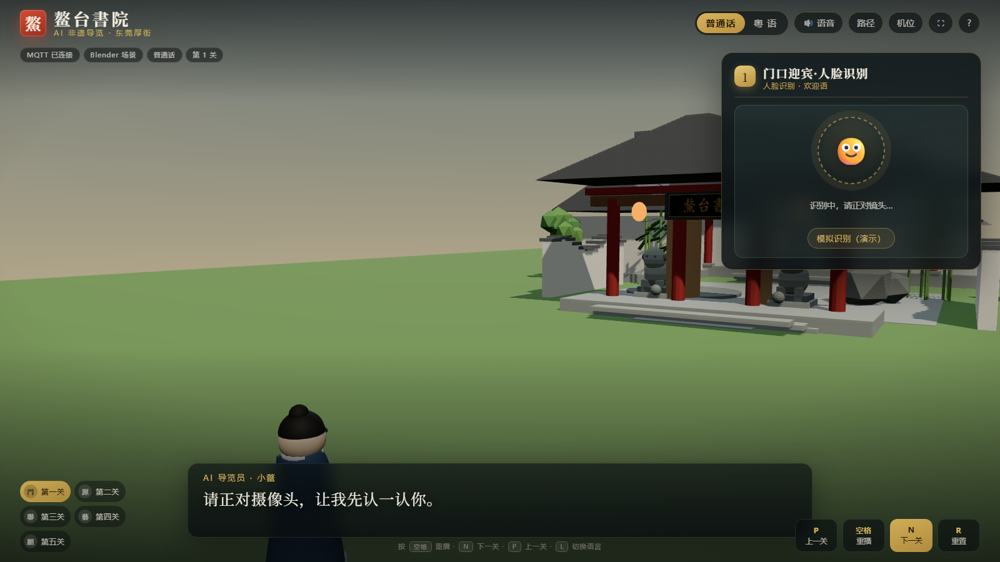

# 智能博物 · 粤地非遗物语之东莞鳌台书院

一套「**CyberCAM（K230）看 + 行空板 K10 听 + 网页 3D 大屏走**」的 AI 非遗导览装置。



## 现场配置（已烧录 · 2026-10-20）

| 项 | 值 | 状态 |
|---|---|---|
| WiFi | `LYT` / `lyt13509018386`（2.4GHz ch1） | ✅ K10 + CyberCAM |
| MQTT | `159.75.137.223:1883`（`siot`/`dfrobot`） | ✅ 三端连通 |
| K10 | COM22 · IP 192.168.10.69 · RSSI −41 | ✅ 10s 心跳在线 |
| CyberCAM | COM20 · IP 192.168.10.62 | ⚠ 需断电重启后恢复 |
| 网页 | http://127.0.0.1:8000/ | ✅ 显示「MQTT 已连接 · K10 在线」 |

## 30 秒跑起来

```bash
python 03_网页3D/bridge/run_demo.py     # 或双击「一键演示.bat」
# 浏览器打开 http://127.0.0.1:8000/
```

## 语音（双轨，都已生成 28+28 条）

| 语言 | 引擎 | 音色 |
|---|---|---|
| 普通话 | 阿里云 **Qwen3-TTS**（`qwen3-tts-flash`） | Cherry |
| 粤语 | 微软 **edge-tts** | zh-HK-HiuMaanNeural（真粤语） |

> 千问 TTS 的 `language_type` 官方只支持 chinese/english/german/italian/portuguese/spanish/japanese/korean/french/russian/auto，**不含粤语**；用 chinese 读粤语文本会读成普通话。因此粤语保留 edge-tts，普通话升级为千问。
> 试听对比页：http://127.0.0.1:8010/ （13 个音色样本）

## 目录

| 目录 | 内容 |
|---|---|
| [01_固件](01_固件/) | CyberCAM（含 `display.py` 安全显示层）、K10（语音唤醒 + 关键词 + 心跳） |
| [02_数据](02_数据/) | 双语文案、56 条语音（2.5 MB）、人脸样张、地图、语音生成脚本 |
| [03_网页3D](03_网页3D/) | Three.js 五关交互 + Flask/MQTT/SSE 桥 + QC 截图 |
| [04_PPT](04_PPT/) | 答辩 PPT（14 页） |
| [05_Blender](05_Blender/) | 场景生成脚本、GLB（0.82 MB）、4 张渲染图 |
| [06_文档](06_文档/) | 协议、使用说明（含**卡死原因与修复**）、史实核对、恢复工具 |

## 本轮实测结论

**跑通的：**
- K10 固件烧录 → WiFi 连上 → MQTT 连上 → 每 10s 心跳，网页状态条显示「K10 在线」
- K10 发 `next` / `lang_yue` → 网页小人走到第 2 关、语言切粤语（Playwright 实测）
- CyberCAM 上 MQTT 连上、56 条音频就位、KPU 人脸模型加载、LBPH 训练成功（3 样本 1 人）
- 千问 TTS 28 条普通话音频全部生成

**踩的坑（都已修）：**
1. K10 `asr.speak()` 在部分固件触发 `xQueueGenericSend assert` 崩溃 → **关闭 K10 本地 TTS**，播报交给 CyberCAM
2. K10 一上电就崩溃 → 去掉 setup 里的启动播报
3. CyberCAM 的 APP 与桌面 `lvglsim` 抢 `/dev/fb0`，我直接 kill 桌面导致内核 fb 卡死（SSH 端口在但无响应）→ 新增 `display.py`：温和停桌面 + 超时 + 全程 try/except + 失败降级 IDE + 退出恢复桌面 + `--no-display` 参数
4. 网页不显示设备在线 → 后端加心跳时间戳与 `k10_online` 判定，前端 15s 轮询

## 需要你做的一件事

**CyberCAM 断电再上电**（USB-C 拔掉 5 秒），然后：
```bash
python 06_文档/tools/cam_recover.py --deploy --start
```
它会重新部署最新代码（含安全显示层）并启动 APP。
